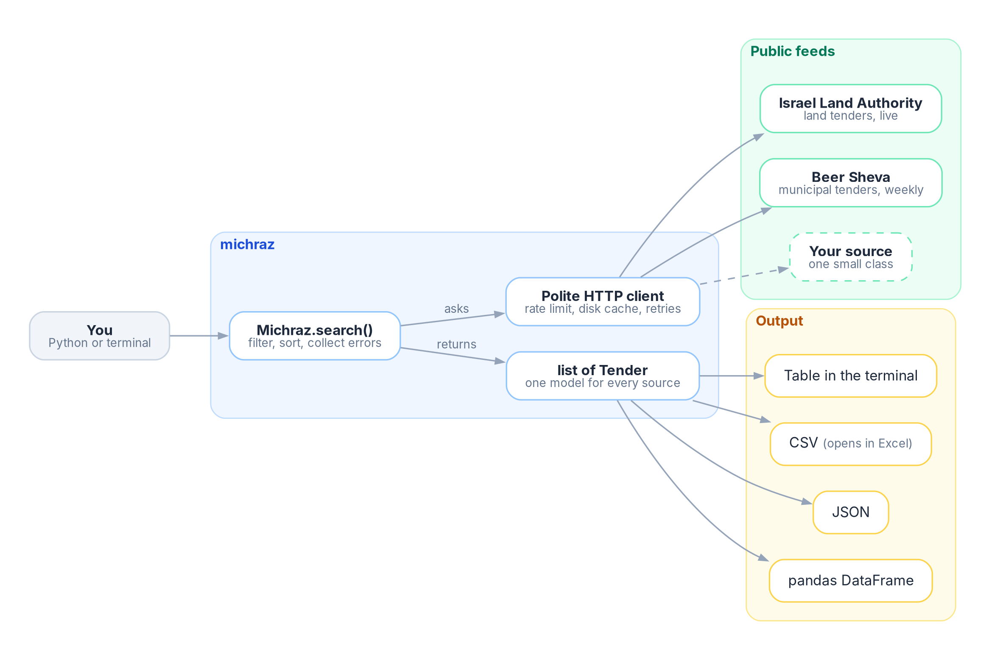
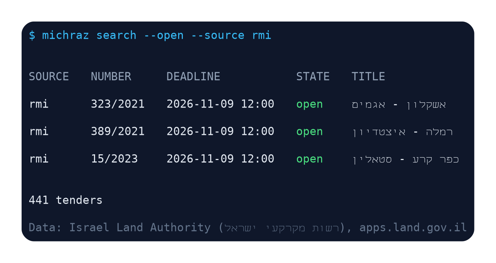
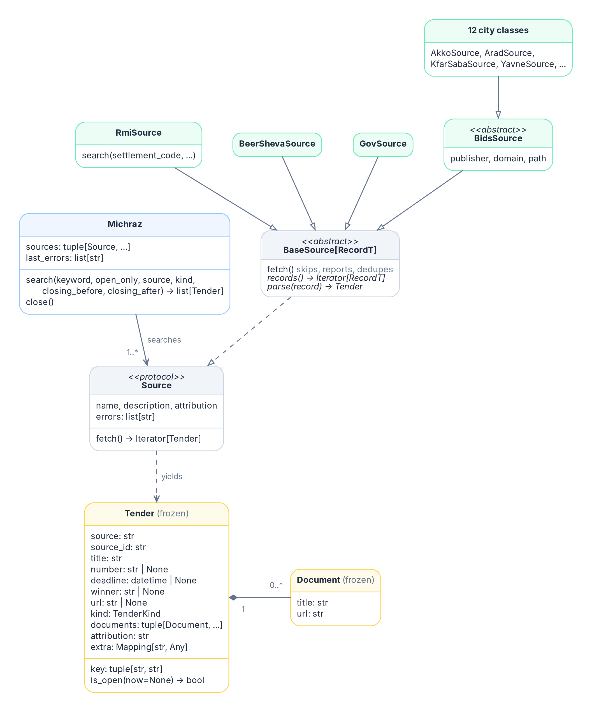
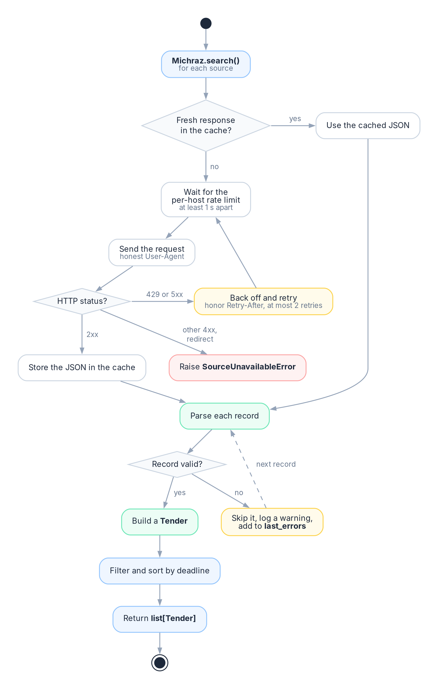

# michraz

[](https://pypi.org/project/michraz/)
[](https://pypi.org/project/michraz/)
[](https://github.com/Zikithezikit/michraz/actions/workflows/ci.yml)
[](https://github.com/Zikithezikit/michraz/blob/main/LICENSE)

Israeli public tenders (מכרזים) in Python. One `Tender` object, whichever site it came from.

Sources today: Israel Land Authority land tenders, central-government tenders (mr.gov.il), Beer Sheva, and 12 more
municipalities (Akko, Arad, Beit Shemesh, Dimona, Kfar Saba, Kiryat Motzkin, Nesher, Netivot, Nof HaGalil, Savyon,
Tamra, Yavne). The first search takes around 20 seconds because mr.gov.il is read page by page. After that the
responses are cached for an hour.

> Unofficial client. It can lag or miss tenders, and parsing can break when a source changes. Confirm deadlines on
> the publisher's page before you act. Not affiliated with the Israel Land Authority or any municipality.



## Install

```bash
pip install michraz            # Python 3.10+
pip install "michraz[pandas]"  # optional, for DataFrames
```

## Use it

```python
from michraz import Michraz, to_csv

with Michraz() as m:
    tenders = m.search(keyword="גינון", open_only=True)

for t in tenders:
    print(f"{t.deadline:%Y-%m-%d}  {t.title}  {t.url}")

to_csv(tenders, "tenders.csv")
```

Results are sorted by deadline. Filter by `source`, `closing_before` and `closing_after` (dates or aware
datetimes) too. Each tender has an `attribution` string. Keep it when you republish the data.

Or from the terminal:

```bash
michraz search --open --source rmi
michraz search --keyword גינון --csv gardening.csv
```



A record that fails to parse is skipped and listed in `m.last_errors`. If one source is down, the others still
answer and its error is listed there too. `SourceUnavailableError` is raised only when every searched source fails. More scripts are in [examples](https://github.com/Zikithezikit/michraz/tree/main/examples).

## Add a source

Subclass `BaseSource`. Say how to read the records and how to turn one into a `Tender`. Skipping bad records,
reporting them in `errors` and dropping repeats is shared.

```python
from michraz.sources import BaseSource


class MySource(BaseSource[dict]):
    name = "my-city"
    description = "My city's tenders"
    attribution = "My City, my-city.example"

    def records(self):
        yield from self._client().get_json(self.name, "https://my-city.example/api/tenders")

    def parse(self, record):
        return Tender(source=self.name, source_id=record["id"], title=record["title"], attribution=self.attribution)
```

Then `Michraz([MySource()])`. A city that uses the shared `/bids/` page needs only a name, a publisher and a domain
(see `michraz/sources/municipal.py`).



Fields are documented in [docs/model.md](https://github.com/Zikithezikit/michraz/blob/main/docs/model.md), and how
each source was checked in [docs/sources.md](https://github.com/Zikithezikit/michraz/blob/main/docs/sources.md).

## Polite by default



Honest User-Agent, one request per second per host, one-hour disk cache, at most two retries. Tune it with
`Michraz(cache_dir=None, cache_ttl=..., min_interval=...)`.

## Limitations

- RMI region, type, purpose and status are raw numeric codes in `tender.extra`. No verified label table exists.
- RMI tender details and documents are not fetched yet.
- Keyword search is a Unicode-normalized substring match. No stemming.

## Development

```bash
make venv && make check
```

Tests run against recorded responses and never touch the network. See
[CONTRIBUTING.md](https://github.com/Zikithezikit/michraz/blob/main/CONTRIBUTING.md).

MIT licensed. The data belongs to its publishers and carries their licenses.
