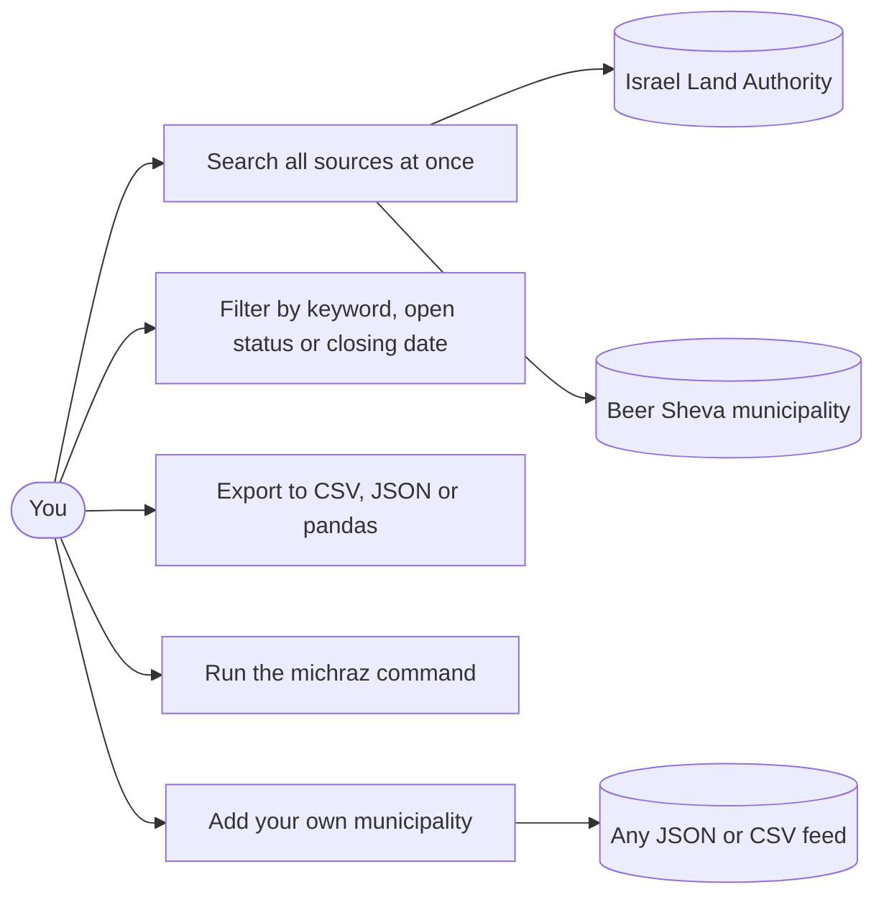
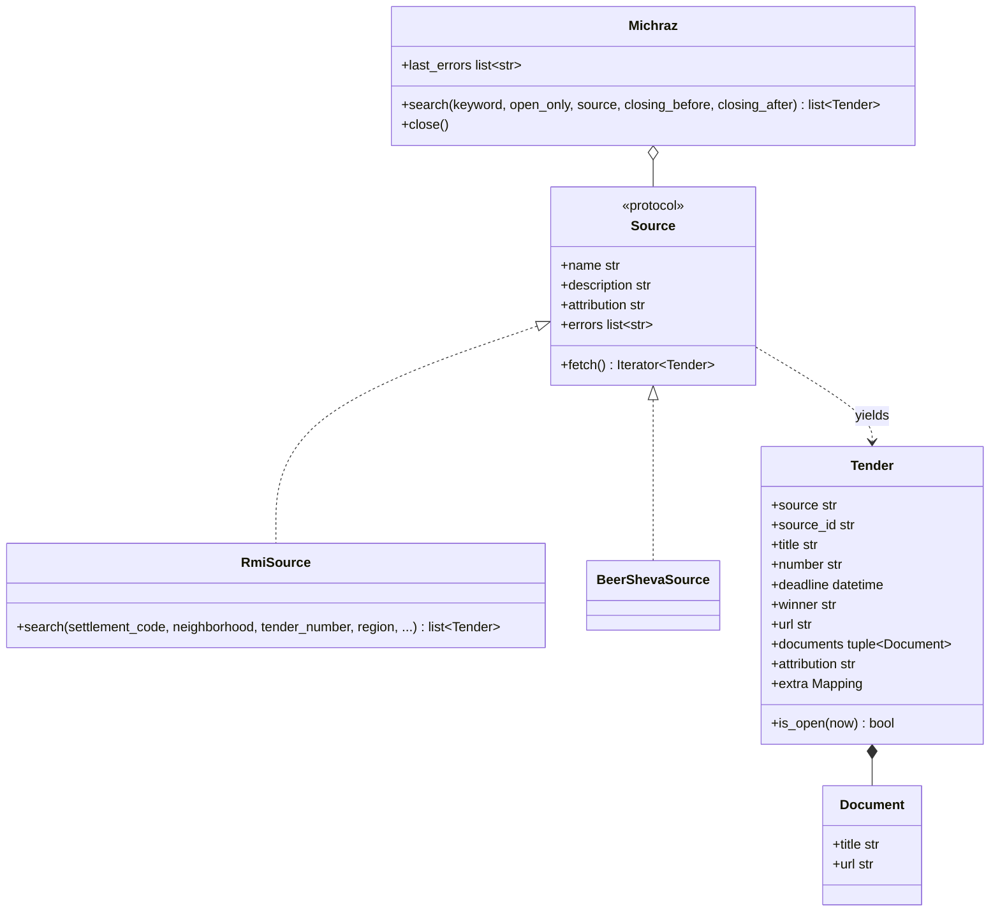
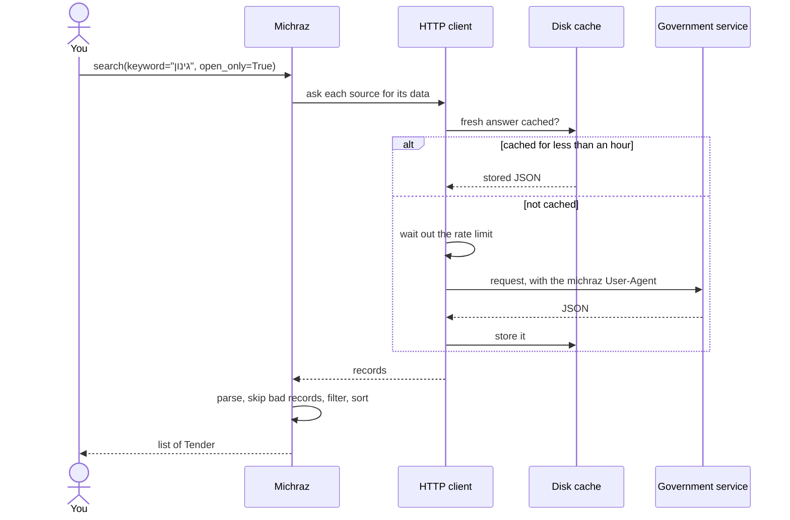
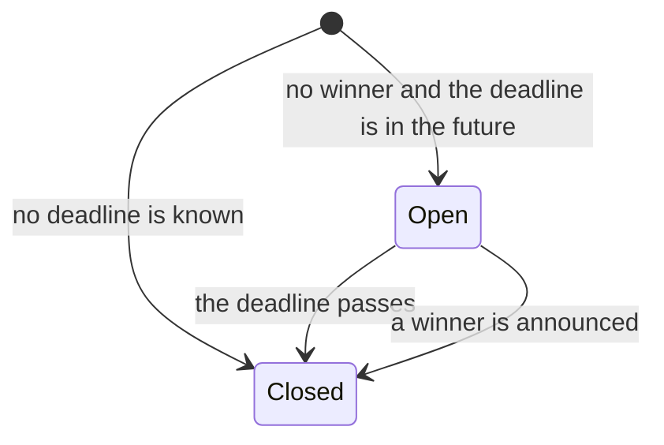

# michraz

[](https://pypi.org/project/michraz/)
[](https://pypi.org/project/michraz/)
[](https://github.com/Zikithezikit/michraz/actions/workflows/ci.yml)
[](LICENSE)

Search Israeli public tenders (מכרזים) from Python or the command line, with one data model for every source.

Today it covers Israel Land Authority land tenders and Beer Sheva municipal tenders. You can filter them, export
them to CSV, and add another municipality with one small class.

> michraz is an unofficial client. It can lag or miss tenders and parsing can break when a source changes. Always
> confirm deadlines and conditions on the publisher's official page before you act. Not affiliated with the Israel Land
> Authority or any municipality.

## Why

Tender data in Israel is spread around. The Israel Land Authority runs its own site, each municipality publishes
on its own, and the national procurement datasets on data.gov.il stopped updating in 2021. If you want to know
what is open for bids this week, you visit several sites that each look different.

michraz reads the machine-readable feeds those sites already expose and gives you the same `Tender` object
whichever one it came from. It is a small library on purpose: one dependency (`httpx`), no scraping of web pages.

## Install

```bash
pip install michraz
```

Python 3.10 or newer. For DataFrame export: `pip install "michraz[pandas]"`.

## Quick start

```python
from michraz import Michraz

with Michraz() as m:
    for tender in m.search(keyword="גינון", open_only=True):
        print(f"{tender.deadline:%Y-%m-%d}  {tender.title}")
        print(f"  {tender.url}")
        print(f"  {tender.attribution}")
```

`search` returns a list sorted by deadline. Tenders without a known deadline come last.

## What you can do with it



### How the pieces fit

`Michraz` asks each source for tenders. A source is anything with a name, an attribution line and a `fetch()`
method that yields `Tender` objects.



### What happens during a search

Requests go through one client that waits between calls, caches answers on disk and identifies itself honestly.



### When a tender counts as open



A deadline equal to the current moment counts as closed.

## Command line

```bash
michraz search --open --source rmi
michraz search --keyword גינון --csv gardening.csv
michraz search --json | jq '.[0]'
michraz sources
```

Real output, 2026-11-04:

```text
SOURCE  NUMBER    DEADLINE          STATE  TITLE
rmi     323/2021  2026-11-09 12:00  open   אשקלון - אגמים
rmi     389/2021  2026-11-09 12:00  open   רמלה - איצטדיון
rmi     15/2023   2026-11-09 12:00  open   כפר קרע - סטאלין

441 tenders
Data: Israel Land Authority (רשות מקרקעי ישראל), apps.land.gov.il
```

Hebrew prints in logical order and your terminal does the right-to-left layout. `--no-cache` skips the disk cache.
The exit code is 0 on success and 1 if a service could not be reached.

## More recipes

Query one source and use its own filters (see [docs/sources.md](docs/sources.md) for which are server-side):

```python
from michraz import RmiSource

with RmiSource() as rmi:
    for tender in rmi.search(settlement_code=3750):
        print(tender.number, tender.title, tender.extra["housing_units"])
```

Look at tenders closing in a window:

```python
from datetime import date

m.search(closing_after=date(2026, 12, 1), closing_before=date(2027, 1, 1))
```

Export:

```python
from michraz import to_csv, to_dicts, to_dataframe

to_csv(tenders, "tenders.csv")  # UTF-8 with a BOM, so Excel shows Hebrew correctly
to_dicts(tenders)  # JSON-ready dictionaries
to_dataframe(tenders)  # needs michraz[pandas]
```

Add a source by writing a class with `name`, `description`, `attribution`, `errors` and `fetch()`. A complete,
offline example is in [examples/custom_source.py](examples/custom_source.py). The other scripts in
[examples/](examples/) talk to the real services.

If a record cannot be parsed it is skipped, logged at WARNING, and listed in `m.last_errors`. One bad row never
loses the rest. A service that is down raises `SourceUnavailableError`; a response in an unexpected shape raises
`SourceFormatError`. Both inherit from `MichrazError`.

## Sources

| Source | Covers | Refresh | Credit line carried on every tender |
|--------|--------|---------|-------------------------------------|
| `rmi` | Open land tenders of the Israel Land Authority | live | Israel Land Authority (רשות מקרקעי ישראל), apps.land.gov.il |
| `beersheva` | Beer Sheva municipal tenders, open and past, from data.gov.il | weekly | Beer Sheva Municipality (עיריית באר שבע), via data.gov.il, license: Other (Open) |

Please keep the attribution when you republish the data. The CSV has an `attribution` column and the command line
prints it under the table. Field details are in [docs/model.md](docs/model.md).

## Being a polite client

These services are public and not built for load, so michraz:

- sends `michraz/<version> (+https://github.com/Zikithezikit/michraz)` as its User-Agent and never pretends to be a browser;
- waits at least one second between requests to the same host (you can raise this, not go below half a second);
- caches responses for an hour in `~/.cache/michraz`;
- retries at most twice on 429 and 5xx, honors `Retry-After`, and never retries other client errors.

```python
from datetime import timedelta

Michraz(cache_dir=None)  # no cache
Michraz(cache_ttl=timedelta(minutes=10))  # shorter cache
Michraz(min_interval=3.0)  # slower
```

## Known limitations

This is an early release. What is not solid, stated plainly:

- **robots.txt on data.gov.il disallows `/api/`**, which is where the Beer Sheva feed lives. michraz makes one
  cached request per search to the documented open-data API, but the file as written does not permit
  automated access to that path. See [docs/sources.md](docs/sources.md).
- **RMI codes have no labels.** Region, tender type, purpose and status are raw numbers under `tender.extra`. The
  only public table found did not match the live data, so none is shipped. Settlement names are shipped and verified.
- **RMI ignores most search filters server-side.** Only settlement and neighborhood are applied by the server;
  michraz applies the rest after downloading the list.
- **RMI tender links are unconfirmed.** `tender.url` follows the site's own route definition but was not opened in
  a browser.
- **Some RMI fields are not understood**: `khal_yaad_rashi` and `mekuvan` are kept as the API sends them.
- **RMI documents and details are not fetched yet**, so `documents` is empty for RMI tenders.
- **Beer Sheva tender numbers are not unique** (some are blank), so tenders are keyed by the municipality's own item id.
- Keyword search is a plain substring match after Unicode normalization. There is no stemming, so `גינון` will not find `גינה`.
- The terms of use of the source sites were not reviewed.

## Development

```bash
make venv
make check        # ruff, mypy --strict and pytest: what CI runs
make cov          # coverage report
pytest -m live    # hits the real services once each; manual only
```

The test suite never touches the network. It runs on recorded responses, and a guard fails any test that opens a
socket. See [CONTRIBUTING.md](CONTRIBUTING.md).

## License

MIT. The data belongs to its publishers and is subject to their licenses; see the credit lines above.
